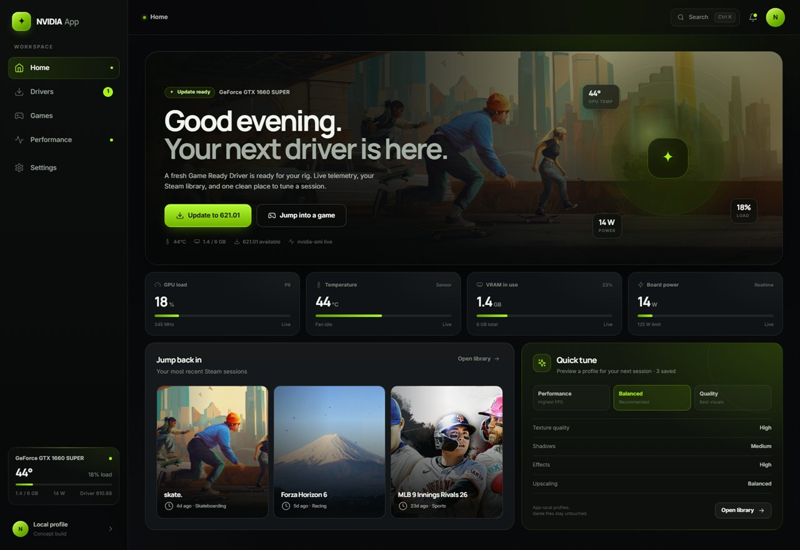
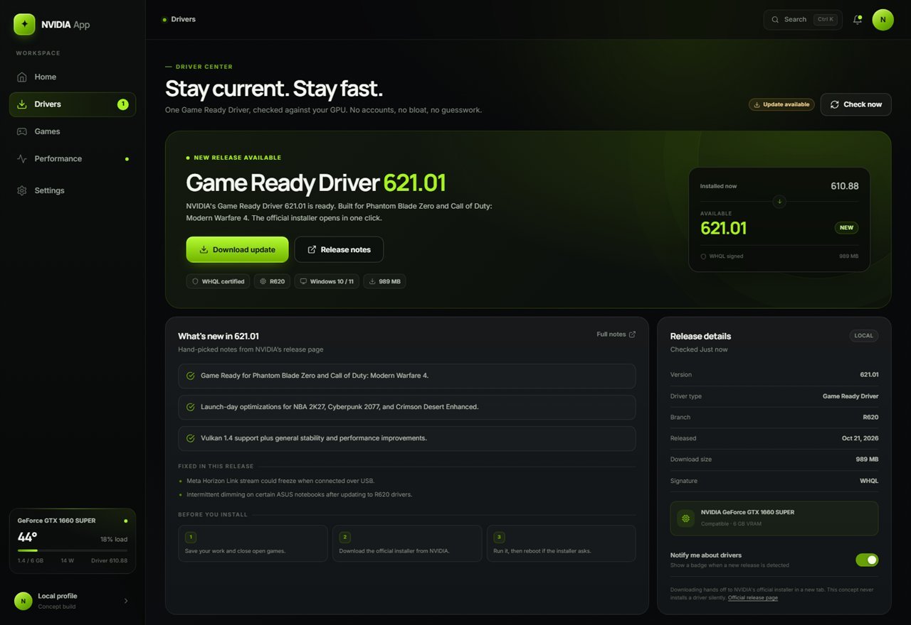
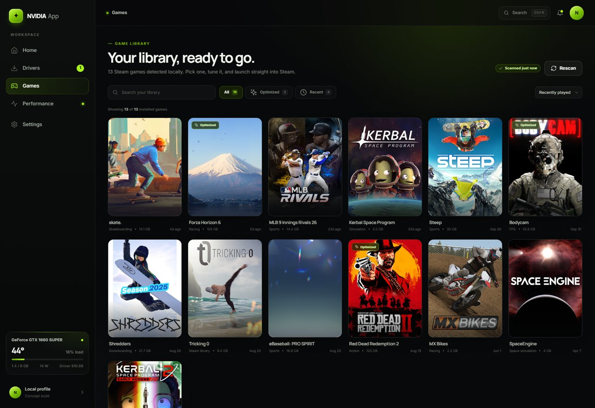
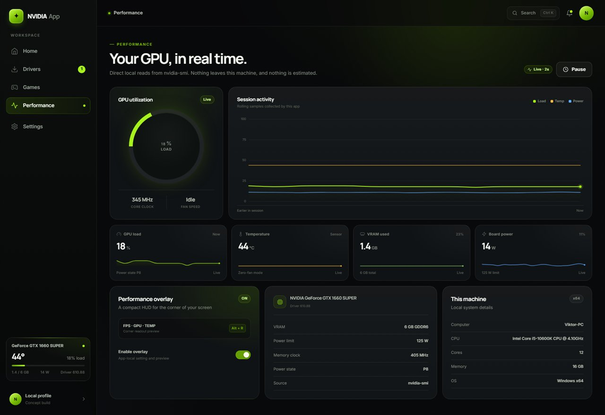
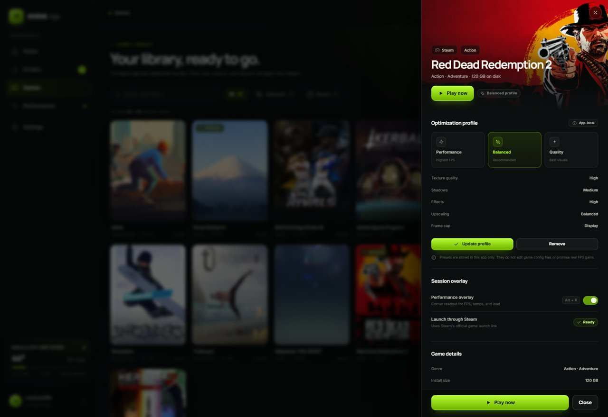

# NVIDIA App — Reimagined

A focused, local-first take on the NVIDIA App: five destinations, real GPU telemetry, your actual Steam library, and a short path to the things people open the app for.

This is an original concept UI. It is not affiliated with NVIDIA, and it does not copy NVIDIA's proprietary frontend code or assets.



## Quick start

Requirements: **Node.js 20+** and an NVIDIA GPU with `nvidia-smi` on `PATH` for live telemetry.

```powershell
npm start
```

Open **http://127.0.0.1:4173**. There is no build step and no runtime dependency to install.

`npm run dev` starts the same server with Node's file watcher.

## The five pages

| Page | What it does |
| --- | --- |
| **Home** | Live GPU load, temperature, VRAM, power, driver status, recent Steam games, and a quick tuning preset. |
| **Drivers** | Compares the installed driver with the latest curated release, explains what changed, and hands the download off to NVIDIA's official installer. |
| **Games** | Discovers installed Steam games from local manifests, filters/sorts the library, shows game details, saves app-local optimization profiles, and launches games through Steam. |
| **Performance** | Live gauge, rolling telemetry chart, and per-metric sparklines sourced from `nvidia-smi`. |
| **Settings** | Local preferences, detected system information, reset controls, and a plain-language explanation of what the app does and does not touch. |

### Screens

| | |
| --- | --- |
|  |  |
|  |  |

## Real vs. simulated

Honesty was part of the design brief, so the app separates live local data from concept behavior.

| Capability | Status | Details |
| --- | --- | --- |
| GPU name, driver, temperature, load, VRAM, power, clocks | **Real** | Polls `nvidia-smi` every 2.5 seconds. The server samples history every 2 seconds. |
| GPU telemetry history | **Real** | In-memory samples recorded by the local server; no analytics or upload. |
| Steam library discovery | **Real** | Reads `appmanifest_*.acf` files and `libraryfolders.vdf` from local Steam libraries, de-duplicated by App ID. |
| Steam artwork | **Real / cached** | Portrait covers and hero art are downloaded from Steam's CDN and cached under `public/covers` and `public/heroes`. Missing portrait art falls back to wide hero art. |
| Game launch | **Real handoff** | Calls the `steam://rungameid/<appid>` protocol through the operating system. |
| Latest driver availability | **Curated snapshot** | `data/latest-driver.json` contains the latest release metadata captured for this concept. It is not a live NVIDIA update API. "Check now" rereads the snapshot rather than promising a network check. |
| Driver installation | **Official handoff** | The download button opens NVIDIA's official `.exe` in a new tab. This app never downloads or installs a driver itself. |
| Game optimization presets | **Simulated / app-local** | Performance, Balanced, and Quality presets are stored in `localStorage`. They do not edit game config files and do not claim measured FPS gains. |
| Performance overlay toggle | **App-local preference** | No overlay is injected into games. The app explains this in Settings and in the game sheet. |
| Account, cloud sync, telemetry upload | **None** | The server binds to `127.0.0.1` and serves everything locally. |

The driver shown in the screenshots is **621.01** compared with the machine's installed **610.88**. The metadata, highlights, official download URL, and release page are recorded in `data/latest-driver.json`.

## How it works

- **Server:** zero-dependency Node HTTP server (`server.js`) binds to `127.0.0.1:4173`.
- **Client:** vanilla HTML, CSS, and JavaScript (`public/`) with hash routing, no framework and no bundler.
- **APIs:**
  - `GET /api/system` — live `nvidia-smi` snapshot
  - `GET /api/history` — rolling telemetry samples
  - `GET /api/driver` — installed vs. latest metadata
  - `GET /api/games` — discovered Steam library
  - `POST /api/games/:id/launch` — Steam protocol handoff
  - `GET /covers/:id.jpg` — lazy cover cache
- **Storage:** preferences and game profiles live in `localStorage`; nothing is sent anywhere.

The app degrades gracefully if `nvidia-smi`, Steam, or cached artwork is unavailable, and it labels the fallback state rather than inventing live data.

## Design notes

The target analysis used REA against the locally installed NVIDIA App's CEF/Angular frontend at `C:\Program Files\NVIDIA Corporation\NVIDIA App\www`. That established the product's core surfaces (Home, Drivers, Games/Performance, Settings), its dark visual language, and its signature green `#76b900`. The implementation here is an independent reconstruction with a smaller scope: no account layer, no game-file modification, and an explicit driver handoff instead of a fake install.

- Dark charcoal surfaces, NVIDIA green accents, and a restrained lime glow.
- Manrope for display type, Inter for UI copy, locally hosted WOFF2 files.
- Bento-style cards, live canvas gauges/sparklines, and a game detail sheet.
- Command palette (`Ctrl/Cmd + K`), keyboard card activation, visible focus states, focus trapping in overlays, and reduced-motion support.
- Responsive at desktop, tablet, and phone widths; the sidebar becomes an off-canvas drawer below 900 px.
- Copy avoids claiming that presets improve FPS or that the concept installs drivers automatically.

## Project layout

```
server.js                 local HTTP server and data adapters
data/latest-driver.json   curated latest-driver snapshot
public/index.html         app shell, navigation, icon sprite
public/app.js             routing, views, live updates, interactions
public/styles.css         design system and responsive layout
public/covers/            cached Steam portrait covers
public/heroes/            cached Steam hero art and fallbacks
public/fonts/             locally hosted Inter and Manrope
public/icon-512.png       PWA / touch icon
docs/screenshots/         README screenshots
```

## Limitations

- Steam discovery currently targets standard local Steam installations and library folders; unusual custom layouts may need a rescan or path adjustment.
- Cover art depends on Steam CDN availability the first time it is requested.
- The latest-driver snapshot is only as current as the last update to `data/latest-driver.json`.
- Live telemetry requires a working NVIDIA driver and `nvidia-smi`; otherwise the UI shows its unavailable/demo state.
- This is a concept, not a replacement for NVIDIA's driver stack, installer, or overlay.
